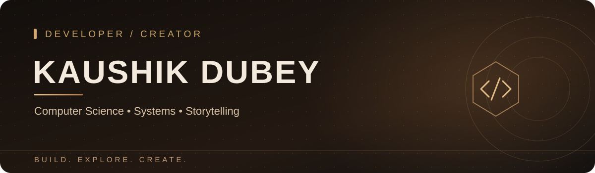

 

### Hey, I'm Kaushik 👋

**Computer Science student · Aspiring kernel developer · Visual storyteller**

I love figuring out how computers work — from low-level systems and hardware to the experiences we build on top.

---

### /whoami

I'm pursuing **B.Tech in Computer Science & Engineering** at **Chandigarh University, Uttar Pradesh campus**. My biggest technical curiosity is **systems programming**: kernels, the way hardware and software communicate, and what happens underneath the user interface.

Outside the terminal, I explore **photography, filmmaking, and visual storytelling** — and I'm fascinated by **automotive and PC hardware**.

- 🧠 **Deep-diving into:** operating systems, computer architecture, and low-level engineering
- 🛠️ **Building with:** HTML, CSS, JavaScript, Git, and GitHub
- 🎯 **Working toward:** a strong foundation for kernel and systems development
- 🎬 **Creating beyond code:** cinematic visuals and digital experiences

### /current_focus

| 01 — Systems | 02 — Hardware | 03 — Creative tech |
| :--- | :--- | :--- |
| Learning how software works closer to the machine | Exploring chips, computers, and engineering | Blending coding with design and storytelling |

### /toolkit

### /featured_work

**[Personal Portfolio — 1st-try](https://github.com/zenetsu022-source/1st-try)**  
An interactive portfolio combining web development, motion, and a cinematic aesthetic.

### /github_activity

<b>Contribution activity</b>

 

---

### Let's build something interesting.

**Code, cameras, hardware, or a great idea — I'm always curious.**

[LinkedIn](https://www.linkedin.com/in/kaushik-dubey-171a82237) · [YouTube](https://www.youtube.com/@gw_mercy) · [Instagram](https://www.instagram.com/zenetsu022/) · [GitHub](https://github.com/zenetsu022-source)

Built with curiosity • zenetsu022-source

